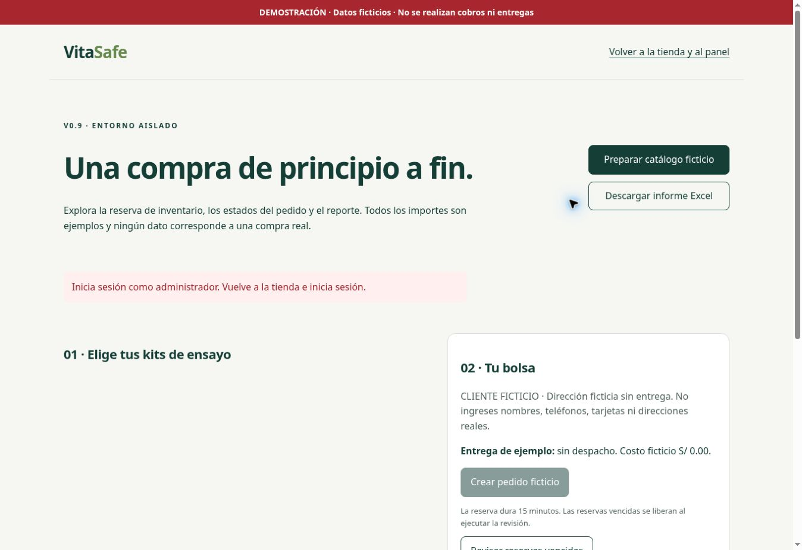

# VitaSafe v0.9.0-preview — resultados verificados

Fecha: 25 de octubre de 2026. No es candidata comercial v1.0.

## Publicación y aislamiento

- Código probado: `57c3f9ff955743a76f7612fd8eff6dc8d9650d1e`, rama `v06-postgres-excel-onedrive`, PR #2 en borrador.
- Los 22 archivos nuevos/modificados coinciden mediante SHA de blob Git con los archivos locales probados.
- Primer despliegue: `dep-dbf6lkss728c73ea2ipg`, Live.
- Segundo despliegue: `dep-dbf6m7l9fdbs73910vvg`, Live a las 20:49:32 UTC.
- URL: https://vitasafe-v06-pr2-test.onrender.com/
- Solo servicio `srv-dbf1pi0473hc73bi5kog`; despliegue automático desactivado.
- Main conserva `d3ba56bebde80c672246c05fc8fa19a67b7d0415`. Sin fusión, compras reales, contratación ni cambios de contraseña.

## Evidencia de pruebas

| Prueba | Resultado y alcance |
|---|---|
| Suite Node local | 32 aprobadas, 0 fallos |
| Build Render | 32 aprobadas, 0 fallos |
| npm audit | 0 vulnerabilidades reportadas; no equivale a auditoría integral de seguridad |
| Base efectiva | PostgreSQL, no SQLite; base existente PG18 disponible, acceso externo cerrado |
| Reinicio / persistencia | Instancia inicial `rlxlm`: previous_order=false; segunda `nnm79`: previous_order=true y previous_marker=true |
| Administrador | Inicio de sesión HTTP real desde verificador interno, usando secreto existente sin imprimirlo; contraseña incorrecta rechazada |
| Cliente / permisos | Sesión de cliente no accede a administración ni al laboratorio; registro y ventas públicos bloqueados; cuenta cliente no habilitada comercialmente |
| Checkout concurrente | Cuatro solicitudes HTTP simultáneas con la misma clave producen un solo pedido ficticio |
| Pago e inventario | Rechazo, aprobación repetida, preparación, envío, entrega, reembolso y recepción física repetida; stock final igual al inicial |
| Excel nuevo | Descarga HTTP real, lectura del XLSX y 10 hojas verificadas; resumen en soles |
| Excel v0.6 | Cuatro módulos, validaciones de inventario e importación controlada aprobados; catálogo original protegido |
| Respaldos | Snapshot real en memoria y checksum válido; restauración completa en destino vacío probada localmente con PGlite; NO hay copia externa durable acreditada ni ensayo de recuperación PG18 Render |
| Navegador | Catálogo público, barra roja, productos no disponibles, bolsa vacía y laboratorio protegido sin sesión observados; captura V09_LABORATORIO.jpg |
| Pagos sandbox | Firmas y conciliación probadas con transporte simulado; NO se contactó una pasarela real |
| OneDrive | configured=false, connected=false; reintentos probados con transporte simulado, sin autorización OAuth real ni subida |

El verificador se ejecutó dentro del servicio real de Render por HTTP de loopback. Eso verifica aplicación, autenticación y PostgreSQL, pero no sustituye un recorrido autenticado completo por navegador a través del proxy público. La captura muestra la protección sin sesión; no muestra un administrador autenticado. No se ha probado un teléfono físico ni se acredita una prueba móvil emulada.

## Uso

En la tienda de pruebas, pulsar Iniciar sesión e introducir la cuenta administrativa existente. Panel → Datos y Excel → laboratorio, o abrir `/ensayo.html` en el mismo navegador. Preparar catálogo ficticio, seleccionar cantidades y crear pedido. Simular pago y estados; exportar informe. No introducir datos personales reales.

## Pendientes antes de v1.0

1. Integrar el modelo de ensayo con el comercio definitivo y completar recorridos cliente/administrador en navegador y móvil, pruebas de carga y accesibilidad.
2. Aportar catálogo, fotos, precios, cobertura y condiciones auténticos; no se inventaron condiciones comerciales definitivas.
3. Elegir y afiliar pasarela, introducir credenciales sandbox en Render seguro, completar tokenización/webhook público y certificar pagos/reembolsos reales de prueba. Sin cargos ni contratos autorizados.
4. Configurar Microsoft y consentir OAuth desde el panel después de aprobar el Excel; conservar automatización desactivada mientras tanto.
5. Implementar entrega real de notificaciones, cola durable y expiración automática de reservas; reforzar controles distribuidos contra abuso y recuperación de cuentas.
6. Aprobar infraestructura permanente y respaldos cifrados externos con restauración verificada. Base Free actual vence el 24/11/2026 a las 05:28 UTC (00:28 Perú).
7. Completar SUNAT, privacidad, Libro de Reclamaciones, políticas y revisión sanitaria por componente con los datos del titular.
8. Aprobar por separado fusión/despliegue público solo al cerrar las pruebas críticas. DEMO_MODE permanece true.

Instalación, mantenimiento, reversión, comparación de pasarelas y presupuesto orientativo: [V1_PREPARACION.md](V1_PREPARACION.md). El rango de US$20–50/mes es una reserva de planificación, no una tarifa verificada ni una contratación. Dominio, correo, impuestos, comisiones y requisitos comerciales se cotizan aparte.

